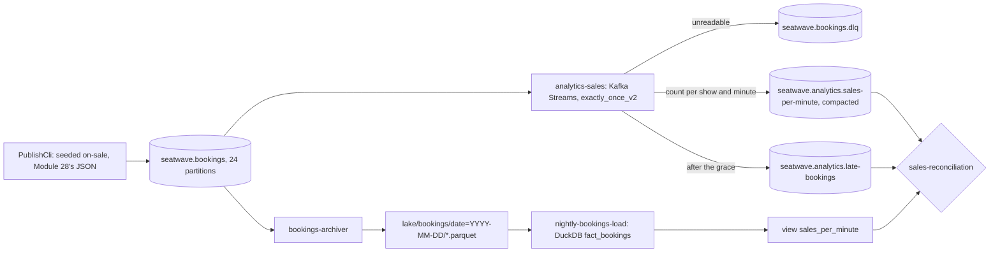

# Architecture of seatwave-analytics

## Packages and the dependency rule

- `io.plainround.seatwave.analytics` (source set `main`, JDK only): the teaching model. `BookingEvent` and `Delivery` (the two clocks as two fields), `OnSaleGenerator` (a seeded on-sale with late, stalled, paused and redelivered records), `MinuteWindows` (event-time windows, watermark, allowed lateness, side output, dedupe by `message_id`, checkpoints), `WarehouseTable` and `NightlyBatch` (idempotent upserts by `booking_id`), `Reconciliation` (the only code that can return `Agreed`), and the four programs `WindowsCli`, `CheckpointCli`, `ReconcileCli`, `LayoutCli`.
- `io.plainround.seatwave.analytics.kafka` (source set `kafka`): the real stream path. `BookingEventJson` (Module 28's tolerant reader and the JSON writer), `SalesPerMinuteTopology` (the job `analytics-sales`), `StackClients` (Module 28's producer and topic helper), `Options`, and the programs `StreamCli`, `PublishCli`, `ArchiverCli` (`bookings-archiver`), `LagProbeCli`.
- `io.plainround.seatwave.analytics.warehouse` (source set `kafka`): the real batch path. `Lake` (Parquet files written by DuckDB), `Warehouse` (runs `warehouse/fact_bookings.sql`), `StreamBatchCheck` (the real path's reconciliation), and `NightlyLoadCli` (`nightly-bookings-load`), `SalesReconciliationCli` (`sales-reconciliation`), `LayoutDbCli`.

The rule: `main` depends on the JDK alone; `kafka` depends on `main` and on Kafka Streams, DuckDB, H2 and Jackson; nothing in `main` depends on `kafka`. Only the `*Cli` classes print or exit.

## Data flow

## Walk-through: one confirm

1. `PublishCli` sends the event as JSON, keyed by `booking_id`; the record's own timestamp is the send time.
2. The job's `OccurredAtExtractor` returns `occurred_at`, so the window is the minute the booking committed. An unreadable value keeps the partition's time and goes, untouched and with Module 27's four headers, to the dead-letter topic; the job carries on.
3. Confirms are re-keyed by `event_id` through the repartition topic `analytics-sales-by-show-repartition`. `LateRouter` compares the record's window end plus the 130-second grace with the task's stream time: too late goes to the late topic keyed `<event_id>@<minute>`, otherwise to the windowed count in `sales-per-minute-store`, whose updates go to the compacted output topic.
4. `bookings-archiver` appends the same event to the lake and commits its offsets only after the file exists.
5. `nightly-bookings-load` keeps the newest version per booking (`QUALIFY`) and upserts it; a second load changes no row.
6. `sales-reconciliation` compares the latest count of every window, plus the late topic's confirms, with the view.

## Decisions and trade-offs

- **Late records go to a topic, not a metric.** The DSL's windowed aggregation drops a record after the grace and only counts it in a dropped-records metric; it has no side output. Three options: rely on the metric and let the batch correct (rejected: the correction cannot be explained window by window, and a lost record looks the same as a late one); rewrite the count with the Processor API and a window store (rejected: more code to own, for the same result); route before the count with the count's own rule (chosen). The router uses the task's stream time, the largest timestamp of every record the task has read, which covers every record the count has seen (the count's own value starts again empty after a restart), so it is never older than the count's: what the router lets through, the count accepts. Every confirm is therefore counted once or kept once. Tested by `SalesPerMinuteTopologyTest.countsEveryConfirmOnceOrKeepsItOnceInTheLateTopic` and two mutants.
- **No dedupe by `message_id` in the Kafka job.** With `exactly_once_v2` a redelivery after a crash or rebalance changes nothing, because state, outputs and offsets commit together; a record republished upstream would be counted twice and shows up in the reconciliation as an overcount. The JDK model keeps the dedupe so the module can show what it buys.
- **DuckDB writes the Parquet files.** `COPY ... PARTITION_BY (date) ... APPEND` writes Hive-partitioned files, so no Parquet library and no Hadoop dependency tree is needed.
- **One broker.** The Docker VM has 8 GB for every project on the machine; replication is Module 27's subject.

## Invariants and where they are enforced

| Invariant | Enforced in | Tested by |
|---|---|---|
| After the lateness and the batch, stream equals batch for every show and minute | `Reconciliation.compare` (model), `StreamBatchCheck.compare` (real path) | `ReconciliationTest`, `StreamBatchCheckTest`, the stack runs |
| Every confirm is counted once or kept once in the late topic | `SalesPerMinuteTopology.LateRouter` | `SalesPerMinuteTopologyTest` |
| An unreadable record never stops the job | `BookingEventJson.read` (never throws), the dead-letter branch | `BookingEventJsonTest`, `SalesPerMinuteTopologyTest` |
| One row per booking; an equal or older version changes nothing | primary key and `WHERE EXCLUDED.booking_version > ...` in `fact_bookings.sql`; `WarehouseTable.upsert` | `WarehouseTest`, `ReconciliationTest` |
| Windows are by event time | `OccurredAtExtractor` | `SalesPerMinuteTopologyTest` |
